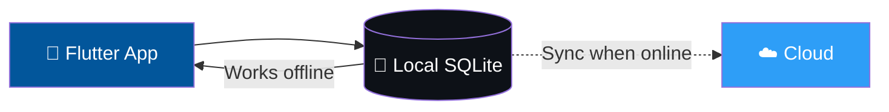

 

---

## 💡 About Me

I'm an ICT professional who turns ideas into working software, from cross-platform mobile apps to enterprise network designs. I build for real-world conditions, including **offline-first** systems that keep working when connectivity doesn't, and I'm combining **Generative AI (Gemini API)** with practical platforms.

- 💼 **Data Assistance Clerk** at Blueline Insurance Agency
- 🎓 **BSc in ICT** graduate, Malawi School of Government (2026)
- 🚀 Founder of **MaestroMw | Hazel IT**, a technology education and services venture
- 🛠️ Currently building **PCM Tech** and **HazelOne**, plus finishing **AgriLandTrust**
- 📫 Reach me at **austingiftnakomah@gmail.com**

---

## 🌟 Featured Projects

<table>
<tr>
<td width="50%" valign="top">

### 📦 PCM Tech
**Offline-first inventory & sales tracker → full POS**

Track stock and sales locally with no internet required, then sync to the cloud automatically when a connection returns.

- 📴 **Offline-first:** works without connectivity
- 🔄 **Cloud sync** when online
- 🧭 **Roadmap:** grow from inventory tracker into a complete POS system

`Flutter` `Dart` `SQLite`

</td>
<td width="50%" valign="top">

### 🏢 HazelOne
**Multi-tenant SaaS business management for SMEs**

One platform for products, inventory, POS/sales, customers, employees, dashboards and reports. Built for Malawian SMEs, with MWK as the default currency.

- 🏗️ Multi-tenant architecture
- 📊 Dashboard and reporting
- 🌍 Designed to extend to web/admin clients

`Flutter` `Firebase Auth` `Cloud Firestore`

</td>
</tr>
<tr>
<td width="50%" valign="top">

### 🌾 AgriLandTrust
**Digital land governance & marketplace platform**

Final-year project combining land-records digitization with applied AI.

- 🤖 **Gemini API** for soil health and crop suitability analysis
- 📍 GPS boundary capture and image uploads
- 🔐 Secret key generation and marketplace transactions
- 📈 Improves transparency and agricultural productivity

`Flutter` `Node.js` `Firebase` `Gemini API`

</td>
<td width="50%" valign="top">

### 🎓 MaestroMw | Hazel IT
**Technology education & innovation venture**

*Learn. Build. Innovate. Lead.*

A vision for a technology learning and innovation ecosystem in Africa, backed by a full blueprint covering architecture, business model and roadmap.

`React` `Node.js` `Python` `PostgreSQL`

</td>
</tr>
</table>

### 🔌 How PCM Tech Works

---

## 🛠️ Technical Arsenal

**Languages**

**Mobile & Web**

**Backend, Data & Cloud**

**AI & Dev Tools**

**Networking**

---

## 💼 Professional Experience

| Period | Role | Organization | Highlights |
|:---|:---|:---|:---|
| 2026 – Present | **Data Assistance Clerk** | Blueline Insurance Agency | 99.8% data accuracy across 1,200+ records |
| 2025 | **ICT Intern** | NEEF | 100% system uptime in critical windows, 95% first-contact resolution, optimized loan management systems, maintained network health for 50+ staff |
| 2025 | **ICT Field Officer** | TNM Mpamba | Supported migration of the Social Cash Transfer Project from manual to secure e-payments; 25% improvement in reporting accuracy |
| Earlier | **ICT Assistant** | Comptech Enterprise | 30% system speed improvement |

---

## 🎓 Academics

**BSc in Information and Communication Technology**, Malawi School of Government (awarded 2026)

- 🏆 **91% Distinction** in Advanced Programming
- 🎯 Final-year project: AgriLandTrust

---

## 🚀 What's Next

- [x] AgriLandTrust: AI-assisted land governance
- [ ] **PCM Tech:** offline-first inventory tracker, then full POS
- [ ] **HazelOne:** finalize Firestore schema and ship the SME platform
- [ ] **MaestroMw | Hazel IT:** grow the technology education ecosystem

---

## 📫 Let's Connect

<i>⭐️ Thanks for stopping by. Explore my repos below!</i>

